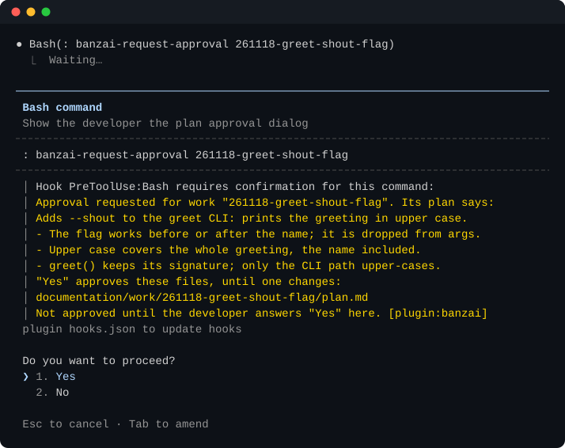

# Banzai

**Spec-driven development for Claude Code: an independent reviewer checks
what the AI agent built, and the requirements, the plan, the report and the
review stay in your repository as Markdown.**

[](https://github.com/Parabolic-Technologies/banzai-claude-plugin/actions/workflows/ci.yml)
[](LICENSE)

An AI coding agent tends to start writing code before you have agreed on
what it should build, and what it decided on the way is gone with the
conversation. Banzai is a Claude Code plugin for developers who want the
agent to work from a spec and a plan, want its change checked by a reviewer
that did not write it, and want to choose, task by task, how closely they
supervise it.

## Quick start

In your project's directory:

```bash
claude plugin marketplace add Parabolic-Technologies/banzai-claude-plugin
claude plugin install banzai@parabolic-plugins --scope project
```

Then start Claude Code there, type `/banzai:setup` once, and give it a first
piece of work:

```text
/banzai:feature let the greet CLI print the greeting in upper case
```

This needs Claude Code 2.1.327 or later, Node.js 22 or later and a project
in Git. [Install](#install) covers an install for all your projects, what
`setup` writes and the steps for a team.

## What a piece of work leaves behind

Planned work is written down in your project:

```text
documentation/
├── decisions/                decision records
└── work/
    └── 261118-greet-upper-case/
        ├── requirements.md   what must be true when it is done
        ├── plan.md           how it will be built
        ├── report.md         what was built and how it was checked
        └── review.md         what the reviewer found
```

Requirements, plans, decisions, reports and reviews are ordinary Markdown
files, so you can read, diff and commit them with the code. A new session
continues a work from them, and they need no plugin to be read.

- **A spec before the code.** `requirements.md` says what must be true when
  the work is done, and `plan.md` says how it will be built. Each choice the
  model made for you is named: before the approval click in
  `/banzai:feature`, and in the last message of `/banzai:auto`.
- **A report after it.** `report.md` says what was built and how it was
  checked.
- **An independent code review.** The reviewer is a subagent with fresh
  context. It gets the files and the commands that show the change, not the
  author's account of it, and a review changes no source file. Every
  finding is checked again before `review.md` is written, and one that
  cannot be confirmed is dropped. `/banzai:review` starts a review when you
  type it; `/banzai:auto` has its plan and its finished change reviewed
  without being asked.

## Two ways to supervise

You pick one for each task by the command you type.

|                       | Human in the loop                             | Human on the loop                                                |
| --------------------- | --------------------------------------------- | ---------------------------------------------------------------- |
| Command               | `/banzai:feature`                             | `/banzai:auto`                                                   |
| You are asked         | Before the code: one click approves the plan. | At the start only: up to four questions in one dialog.           |
| Who checks the plan   | You.                                          | An independent reviewer, before any code.                        |
| Who checks the change | You, and `/banzai:review` when you type it.   | An independent reviewer; blocker and major findings are fixed.   |
| Source files          | The file tools write none until you approve.  | Not held back by the hook.                                       |
| You read              | The plan, then the diff.                      | The last message, then the diff.                                 |
| Use it for            | Work you want to steer before it is built.    | Work you are willing to check after it is built.                 |

In the loop, your approval is one click in a dialog that quotes the plan:



Around both, Banzai adds:

- **Quick fix** with `/banzai:fix`. A small change needs no plan: you type
  the command and it runs directly.
- **Large work** with `/banzai:epic`. Work too large for one plan is split
  into stages and packages and tracked across sessions.
- **Guardrails.** One hook holds the session to your approval. After
  `/banzai:feature` the file tools write no source file until the plan is
  approved, and with no command typed each source change asks you first. A
  change through the shell or an MCP tool cannot be stopped beforehand; it
  is found after the call and shown to you. Where the hook does not run,
  `/banzai:feature` asks for your approval in a question dialog, and
  nothing is held back.

That is six slash commands and one guardrail hook.

Compared with Claude Code's plan mode: the plan is a file in your project,
your approval is bound to that file's content, and it still holds in a new
session.

Compared with letting the agent run on its own: `/banzai:auto` asks before
it guesses what users get, has a reviewer with fresh context check the plan
and the finished change, and tells you which choices it made for you.

## How it works

Banzai runs no agent loop of its own. It is built from Claude Code's
extension points: skills, a subagent and one hook.

- **Skills.** Each of the six commands is a skill that only a typed command
  starts. A seventh skill, `audit`, is not a command: `/banzai:auto` runs
  it in a forked context for its two audits.
- **A reviewer agent.** The audits run as the plugin's `reviewer` agent,
  whose tools are `Read`, `Grep`, `Glob` and `Bash`. It has no file-writing
  tool, and it sees none of the conversation that produced the work.
- **The gate.** One hook: about 800 lines of plain JavaScript in
  [`plugins/banzai/hooks/`](plugins/banzai/hooks), with no dependencies.
  Claude Code starts it as one process per hook event. It reads the event
  as JSON and answers with at most one JSON object.

| Hook event                          | What the gate does                                                                                                                                             |
| ----------------------------------- | -------------------------------------------------------------------------------------------------------------------------------------------------------------- |
| `SessionStart`                      | Gives the model the project's rules and names the newest works.                                                                                                |
| `UserPromptExpansion`               | Notes the entry command you typed. A skill the model starts raises no such event, so a command counts only when you typed it.                                  |
| `PreToolUse`                        | Before a file tool, a shell command or an MCP call: no decision, `ask` or `deny`. It never answers `allow`, so Claude Code's own permission rules still apply. |
| `PostToolUse`, `PostToolUseFailure` | Learns that a call it asked about ran, which means you answered "Yes", and compares the project's source files with what they held before the call.            |

**The approval click.** When a plan is ready, the model runs a shell command
that does nothing, `: banzai-request-approval <work>`. The gate answers it
with `ask`; its text quotes the plan's "For approval" lines and lists the
files your answer approves. The approval is recorded only when Claude Code
reports that this same call ran, which happens only after your "Yes". The
question rides on a shell command because that dialog shows a hook's text,
and the dialog of a file write hides it.
([Decision](DECISIONS.md#2026-11-17-the-approval-click-is-the-hooks-answer-to-a-no-op-shell-command))

**An approval means "these bytes".** The record holds the SHA-256 of
`plan.md`, of `requirements.md` when there is one, and of each decision
record the plan links to. It is valid while the same files with the same
hashes are on disk: unchanged files need no second click in a new session,
and a change to any of them ends the approval. Each record is sealed with an
HMAC under a key in the plugin's data directory, and a record without a
valid seal counts as absent.
([Decision](DECISIONS.md#2026-11-17-an-approval-is-bound-to-file-contents-and-kept-in-the-project))

**What the gate cannot stop, it finds.** Claude Code does not say which
files a shell command or an MCP call changed. In a session where a source
change can be held back, the gate takes Git's list of changed and untracked
source files before and after each such call and compares what they hold. A
change it would not have passed is remembered, and the next shell command
or MCP call asks you about it.
([Decision](DECISIONS.md#2026-11-17-shell-and-mcp-changes-are-detected-then-asked-about))

When the gate itself fails before a tool call, it asks or refuses and does
not let the call pass unseen. When the hook does not run at all, nothing is
held back; see [What the hook holds back](#what-the-hook-holds-back).

It is checked in three ways:

- **Tests** drive the gate the way Claude Code does: one process per event,
  with the event on stdin. `npm test` needs no install, and CI runs it on
  Node.js 22, 24 and 26.
- **Evals** in [`plugins/banzai/evals/`](plugins/banzai/evals) run the
  commands in real Claude Code sessions through `claude plugin eval` and
  grade each run by the files and the tool calls it leaves. They need a
  signed-in Claude Code and are not part of CI.
- **[DECISIONS.md](DECISIONS.md)** gives each design choice with its
  reason, what was rejected and what was not checked.

## Requirements

- Claude Code 2.1.327 or later.
- Node.js 22 or later on your `PATH`. The tests run on Node.js 22, 24 and
  26; older versions are not tested. The hook is plain JavaScript with no
  dependencies. Without Node.js the hook does not run and nothing is held
  back.
- A project in Git. The hook finds changes made through the shell by asking
  Git, so outside Git it sees only changes made with the file tools.

Banzai was built and checked in the terminal client on macOS, and its tests
also run on Linux. In the desktop app the approval dialog and one full
`/banzai:auto` run were seen to work. The IDE extensions and Windows have
not been checked.

## Install

Add the marketplace:

```bash
claude plugin marketplace add Parabolic-Technologies/banzai-claude-plugin
```

Then install the plugin either for one project, from that project's
directory:

```bash
claude plugin install banzai@parabolic-plugins --scope project
```

or for all your projects:

```bash
claude plugin install banzai@parabolic-plugins --scope user
```

With a user install the commands are available in every project, but the
hook acts only in a project that has `documentation/work/`, which `setup`
creates; everywhere else it stays silent.

Then start Claude Code in the project and type:

```text
/banzai:setup
```

`setup` prepares the project once and is safe to run again. It:

- adds `.banzai/` to `.gitignore`;
- enables the plugin and names its marketplace in `.claude/settings.json`;
- creates `documentation/decisions/` and `documentation/work/`;
- offers to record the project's build, test, lint and format commands and a
  size limit for source and test files in your `CLAUDE.md`, or in your
  `AGENTS.md` when there is no `CLAUDE.md`, and asks before it writes them;
- recommends a linter when the project has none, with the commands that
  install and run it and a starting configuration that limits the size of
  a file and the complexity and length of a function. When the project's
  linter lacks such a limit or only warns, it shows the lines that set it.
  It installs no linter and changes no configuration.

Now give it a first piece of work in your own words, for example:

```text
/banzai:feature let the greet CLI print the greeting in upper case
```

The model writes a plan and shows the approval dialog. After your "Yes" it
writes the code and the tests.

Or let it run to the end and report:

```text
/banzai:auto let the greet CLI print the greeting in upper case
```

### For a team

Commit the files `setup` wrote so that your team shares them. The settings
make the marketplace known to a teammate's Claude Code but install nothing.
Each teammate opens the project in Claude Code once and trusts the folder,
which fetches the marketplace, and then runs one of the install commands
above.

## Commands

You type every command yourself; the model cannot start one.

| Command                           | Use it for                                                        |
| --------------------------------- | ----------------------------------------------------------------- |
| `/banzai:setup`                   | Prepare a project, once.                                          |
| `/banzai:fix <what to change>`    | A small, direct change with no plan.                              |
| `/banzai:feature <what to build>` | Planned work: plan, your approval, code, tests, report.           |
| `/banzai:auto <what to build>`    | Planned work with no approval: plan, code, review, fixes, report. |
| `/banzai:review [work]`           | An independent review of a finished change.                       |
| `/banzai:epic <mode>`             | Work too large for one plan; see [Large work](#large-work).       |

Always type the full name. A bare `/review` is a different command.

A *work* is one change with its own directory,
`documentation/work/<work>/`. Its name is the date and the subject, such as
`261118-greet-upper-case`, and that name is what `[work]` stands for.

## Human in the loop: `/banzai:feature`

1. You type `/banzai:feature` and say what to build.
2. When the request leaves open what users get, the model asks you up to
   three questions, each with the answer it recommends. It decides matters
   of form itself, such as names and messages, and marks each such choice.
3. The model writes `plan.md` in the work's directory. A larger request
   first gets `requirements.md`, and a choice that is costly to reverse gets
   a decision record under `documentation/decisions/`, which you accept in
   chat before the plan is written.
4. An approval dialog appears. It quotes the plan's "For approval" section,
   which says what will be built and names each choice the model made for
   you, and it names the files your answer approves.
5. "Yes" approves exactly those files as they are. If one of them changes
   later, the approval ends and the dialog comes again.
6. The model writes the code and the tests, runs the project's checks and
   completes `report.md`.
7. `/banzai:review <work>` starts a reviewer with fresh context and writes
   `review.md`. A review changes no source file; you choose what to fix.

When the work is done, your project holds the files shown under
[What a piece of work leaves behind](#what-a-piece-of-work-leaves-behind).

To continue a work in a new session, type `/banzai:feature <work>`. An
approval of unchanged files still holds.

## Human on the loop: `/banzai:auto`

`/banzai:auto <what to build>` is for work you are willing to check after it
is built instead of before. You answer its questions once and come back to a
finished change with a plan, an independent review and a report.

1. The model reads the code. When the work decides something that is costly
   to reverse (a data model, a public API, a new dependency, a security
   boundary), it asks you in the dialog of step 2 if one question settles
   the decision. Otherwise it stops and names `/banzai:feature` instead.
2. When the request leaves open what users get, a question dialog appears,
   once, with up to four questions and a recommended answer for each. After
   it the model asks nothing more and decides the rest itself.
3. The model writes `requirements.md` and `plan.md`. A reviewer that has not
   seen the conversation audits the plan, and the model corrects what it
   confirms.
4. The model writes the code and the tests and completes `report.md`.
5. The reviewer audits the change. The model fixes the blocker and major
   findings it confirms, the reviewer checks once more, and `review.md`
   records what was closed and what is still open.
6. The last message lists what was built, what you decided, what was decided
   for you, the review's result and the command that shows the change.

No dialog asks you to approve the plan, and the hook holds back no source
change in such a session. Claude Code's own permission prompts still apply:
in its default mode it asks before edits and shell commands. Typing
`/banzai:feature <work>` afterwards asks you to approve that work's plan.

The work leaves `requirements.md`, `plan.md`, `report.md` and `review.md`,
and `review.md` also records the audit of the plan. To continue the work in
a new session, type `/banzai:auto <work>`.

## Large work

`/banzai:epic` keeps track of work that is too large for one plan. The work
is split into stages and packages, and each package is then built with its
own `/banzai:feature` or `/banzai:fix`. Bring your own plan, or give only
the goal: the command asks a few questions, writes the plan and shows it,
and you change it by saying what to change. It keeps the epic's plan,
tracker and log in `documentation/epics/<epic>/` and changes no source file.

| Mode              | What it does                                                         |
| ----------------- | -------------------------------------------------------------------- |
| `start <subject>` | Stores your plan, or drafts one from your goal and answers.          |
| `next`            | Reports where the epic stands and names the next package to build.   |
| `record <entry>`  | Records a started or finished package, a question or a decision.     |
| `gate <N>`        | Lists the evidence for a stage's gate; you decide whether it passed. |

## What the hook holds back

The hook acts in a directory that has `documentation/work/` and in every
directory below it. Everywhere else it stays silent.

To the hook, a source file is every file of the project except the files
under `documentation/` and the `CLAUDE.md` and `AGENTS.md` at its root. So
`package.json`, `.gitignore` and `.claude/settings.json` are source files
too.

- With no command typed, each source change asks you, and "Yes" covers that
  one change.
- After `/banzai:fix`, the session may change source files.
- After `/banzai:auto`, the session may change source files, and a plan
  written in it needs no approval.
- After `/banzai:feature`, the file tools write no source file until the plan
  is approved.
- A source change made through the shell or an MCP tool cannot be stopped
  beforehand. The hook finds it by comparing the project before and after
  the call, and the next shell command or MCP tool call shows you the
  changed files and asks. "No" does not undo the change: revert it yourself.
  Until you accept it, each shell command and each MCP tool call asks again,
  except the desktop app's own task list and summary, and a `Monitor` or
  `PowerShell` call is refused.

The approval dialog shows up to five lines of at most 72 characters from the
plan's "For approval" section, and they come first in its text. When the
list of approved files is long, the terminal folds its end out of view. The
desktop app shows about three rows of the text and scrolls the rest.

The hook behaves the same in every permission mode, `bypassPermissions`
included.

In a run with nobody to answer (`claude -p`), every question of the hook is
refused. `/banzai:fix` still works. A plan cannot be approved, a run with no
command typed cannot change a source file with the file tools, and after a
change through the shell is found, the run's later shell and MCP calls are
refused.

When the hook does not run at all, because hooks are switched off or Node.js
is missing, nothing is held back. `/banzai:feature` then says so and asks
you to approve the plan in a question dialog. That approval is not recorded,
and a run with nobody to answer stops before it changes source.

## Disable or uninstall

To work without the hook, disable the plugin:

```bash
claude plugin disable banzai@parabolic-plugins
```

Approval records are kept in `.banzai/approvals/` in the project, outside
Git. Losing them costs one new click per work. Uninstalling the plugin
deletes the hook's data, and approvals made before then no longer count. To
uninstall and keep them, give the scope you installed with, `project` or
`user`:

```bash
claude plugin uninstall banzai@parabolic-plugins --scope project --keep-data
```

## Limits

- The gate stops mistakes, not attacks. It is not a sandbox, and it is not
  protected against a model that works to get around it.
- It does not see changes to files that Git ignores, changes in a project
  outside Git, or changes a background process makes after its command ended.
- Each shell or MCP call takes about 80 ms longer on a small repository, and
  an estimated 150 ms on one with 7,000 files. After `/banzai:auto`, and
  after `/banzai:fix` while no planned work is attached, the session may
  change source files anyway: the project is not compared, and a call takes
  about 30 ms less on a small repository and about 50 ms less on a large
  one.
- Plan approvals, checks and reviews are no guarantee that a change is
  correct. Read the diff before you commit.

[DECISIONS.md](DECISIONS.md) gives the reason for each design choice and
what was rejected.

## Community

Report reproducible problems through
[GitHub Issues](https://github.com/Parabolic-Technologies/banzai-claude-plugin/issues).
To contribute, read [Contributing](.github/CONTRIBUTING.md). Report
vulnerabilities through the [security policy](.github/SECURITY.md). Changes
are listed in the
[changelog](CHANGELOG.md).

## Author and license

Owned by **Parabolic Technologies, Inc. ("Parabolic")**.
Created by [Alexander Torosh](https://github.com/alexander-torosh).
Contact: [alexander@parabolic.io](mailto:alexander@parabolic.io).
Source: [Parabolic-Technologies/banzai-claude-plugin](https://github.com/Parabolic-Technologies/banzai-claude-plugin).

Banzai is licensed under the [Apache License, Version 2.0](LICENSE).
See [NOTICE](NOTICE), [third-party information](THIRD_PARTY_NOTICES.md),
[Terms of Use](TERMS_OF_USE.md), and [Names and Logos](TRADEMARKS.md).
Using Banzai does not require open-sourcing your own project. Community
participation follows the [Code of Conduct](.github/CODE_OF_CONDUCT.md).
